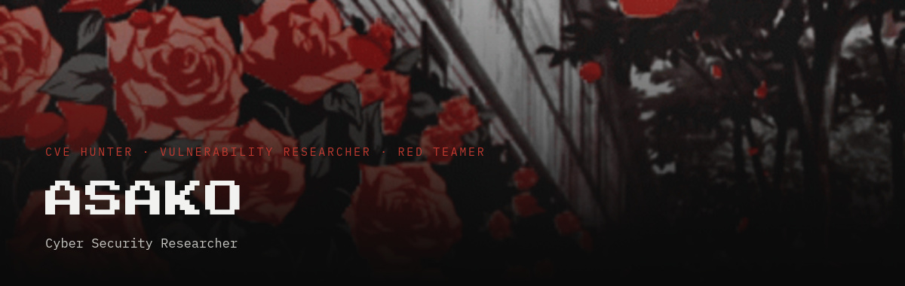

Finding vulnerabilities, writing reports, annoying software responsibly.

I work in security, mostly on web applications. Alongside that, I build and contribute to open source.

TL;DR — I write things and I break things.

## Selected work

- **[Security advisories](https://donasako.fr/en/cves/)** — disclosed vulnerabilities.
- **[CSSinj](https://github.com/DonAsako/CSSinj)** — tool that exploits CSS injection to exfiltrate data from web applications.
- **[Eskoz](https://github.com/DonAsako/eskoz)** — Django project for building a multilingual blog.

## Certifications

- **[CPTS](https://academy.hackthebox.com/preview/certifications/htb-certified-penetration-testing-specialist)** — Certified Penetration Testing Specialist · Hack The Box · 2026
- **[CWES](https://academy.hackthebox.com/preview/certifications/htb-certified-web-exploitation-specialist)** — Certified Web Exploitation Specialist · Hack The Box · 2025
- **[CRTA](https://cyberwarfare.live/product/red-team-analyst-crta/)** — Red Team Analyst · CyberWarfare Labs · 2025

## Stack

&nbsp;&nbsp;&nbsp;&nbsp;&nbsp;&nbsp;&nbsp;&nbsp;

## Profiles

- [X](https://x.com/DonAsako)
- [HackTheBox](https://profile.hackthebox.com/profile/019c3eab-e85b-7064-99c5-91e034c12f68)
- [Root-Me](https://www.root-me.org/DonAsako)

## Contact

- **Web** — [donasako.fr](https://donasako.fr/)
- **Email** — contact `[at]` donasako `[dot]` fr
